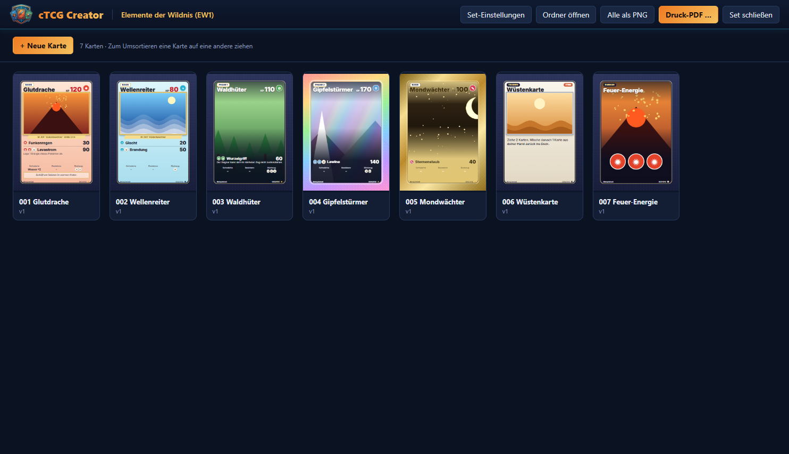
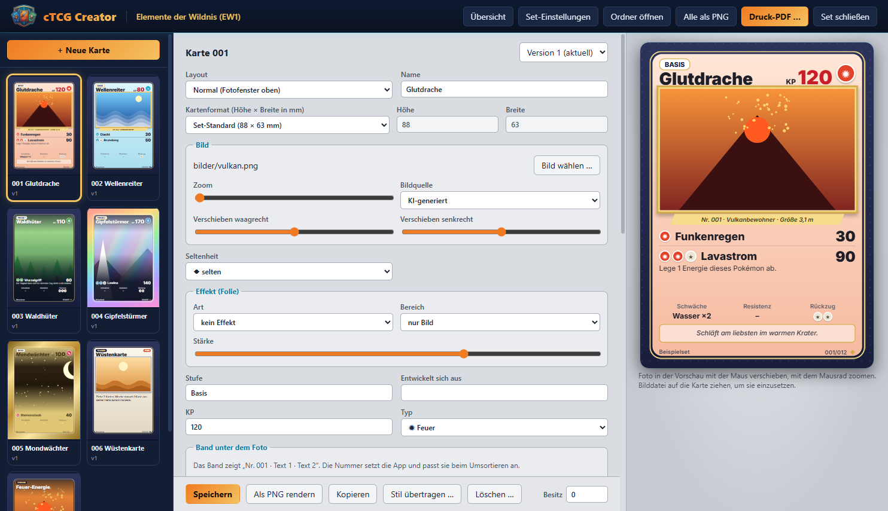
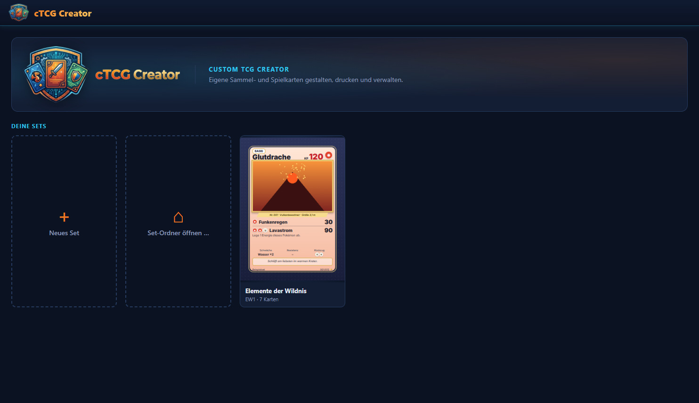

# cTCG Creator (Custom TCG Creator)

Desktop-App zum Gestalten, Drucken und Verwalten eigener Sammel- und Spielkartensets für Familie, Freunde und die private Community.

## Ziel

Eigene Kartensets erstellen, bearbeiten und verwalten:

- Sammelkarten (Bild, Name, Beschreibung) und Spielkarten im TCG-Stil (Werte, Fähigkeiten, Seltenheit)
- Bilder aus eigenen Fotos oder KI-generiert
- Sets mit Nummerierung, Seltenheiten, Vorlagen/Rahmen pro Set, Versionen einzelner Karten und einer Sammlungsübersicht
- Ausgabe als PNG pro Karte und als druckfertige PDF-Bögen für einen Druckdienst, Format pro Set einstellbar (Standard 63 × 88 mm mit 3 mm Beschnitt)
- Schnittstelle, über die Claude-Instanzen die App zur Kartenerstellung bedienen können

## Privatsphäre

Private Fotos und die daraus entstandenen Karten werden nie veröffentlicht. Sie gehen nur an den privaten Kreis und als Druckauftrag an den Druckdienst. Fotos, Karten und Druckdateien liegen in `data/` und `results/` und werden nicht eingecheckt.

## Screenshots

Die Bilder zeigen ein Beispielset mit selbst gezeichneten Motiven, keine Fotos.

Übersicht eines Sets mit verschiedenen Layouts (Normal, Vollbild, Regenbogen, Gold, Trainer, Energie):



Karte bearbeiten, rechts die Vorschau:



Startseite mit der Liste der Sets:



## Herunterladen

Fertige Windows-Versionen stehen unter [Releases](https://github.com/christianngl/ctcg-creator/releases):

- `cTCG-Creator-Setup-<version>.exe` – Installer mit Startmenü- und Desktop-Verknüpfung
- `cTCG-Creator-<version>-portable.exe` – ohne Installation, einfach starten

Die Dateien sind nicht signiert. Windows SmartScreen fragt deshalb beim ersten Start nach („Weitere Informationen“ → „Trotzdem ausführen“), und Virenscanner wie Norton können sie als unbekannt melden. Dann die Datei in Norton als vertrauenswürdig markieren bzw. unter submit.norton.com als Fehlalarm melden.

Neue Version bauen: Version in `package.json` erhöhen und committen, `npm run dist` (leert `dist/` und bricht ab, wenn es die Version schon als Tag gibt), dann die beiden EXE-Dateien mit genau dieser Versionsnummer als Release `v<version>` hochladen. Dateien einer anderen Version findet die Update-Suche der App nicht.

## Starten

- Windows: `start.ps1` (oder die Desktop-Verknüpfung von pinx). Beim ersten Start werden die Abhängigkeiten installiert, dafür braucht es Node.js.
- Andere Systeme: `npm install`, dann `npm start`.
- Tests: `npm test`

## Wo die Daten liegen

Jedes Set liegt in einem eigenen Ordner, den du beim Anlegen auswählst. Darin stehen normale Dateien, die du im Explorer siehst und sichern kannst: `set.json`, `karten/` (jede Version einer Karte), `bilder/`, `sammlung.json` sowie `export/png/` und `export/druck/`. Set-Ordner liegen außerhalb dieses Repos.

Die Liste der Sets und die Einstellungen der App stehen in `%APPDATA%\card-creator`. Mit der Umgebungsvariable `CTCG_DATEN=<ordner>` nimmt die App stattdessen diesen Ordner, z. B. für Screenshots mit einem Beispielset (in `zuletzt.json` steht dann nur dessen Pfad).

Die Vorlagen (nur Rahmen und Layout, ohne Fotos und Texte) liegen unter `src/vorlagen/`.

## Kommandozeile für Claude Code

`node src/cli/index.js hilfe` zeigt alle Befehle. Die Ausgabe ist immer JSON. Details stehen in [`claude/CLAUDE.md`](claude/CLAUDE.md).

## Arbeiten mit Claude

Die Anweisungen für Claude stehen in [`claude/CLAUDE.md`](claude/CLAUDE.md): Rolle, System-Prompt, Ein-/Ausgabe-Schema, Sicherheitsregeln und Testfälle. Bevor du am Projekt arbeitest, dort die Sicherheitsregeln lesen.

Eingesetzte Tools: Claude Code (Entwicklung), Claude-Instanzen (Bedienung der App)

## Projektstruktur

```text
ctcg-creator/
├─ CLAUDE.md
├─ README.md
├─ .gitignore
├─ project.config.yaml
├─ projekt.ini
├─ claude/
│  └─ CLAUDE.md
├─ src/
├─ data/
├─ notebooks/
├─ tests/
├─ docs/
├─ infra/
└─ results/
```

## Kontakt

Owner: Wildhunt Community

---
Tags: sammelkarten, kartendesign, druck, privat · angelegt am 2026-10-23
